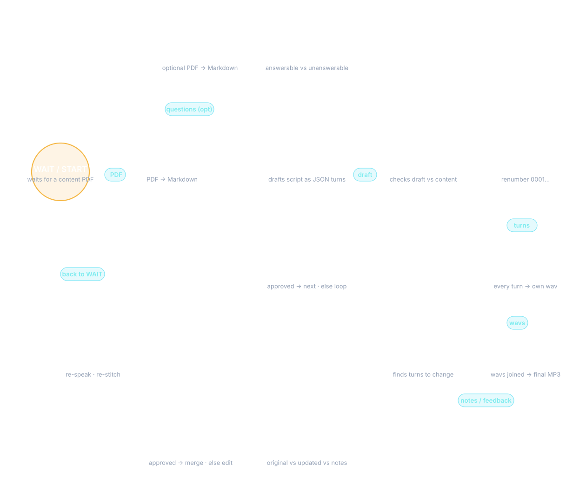

# Pipeline, Configuration, and Development

All commands are run from the **repository root**, not from inside `src/`.
For installation, see the root [README](../README.md).

```bash
python -m src.pipeline [options]
```

The `src.pipeline` module is the CLI entrypoint. It orchestrates:
PDF → Markdown → actor-critic script → optional Indic translation → TTS → MP3.



## Architecture and files

The LangGraph generation loop runs Actor → Critic → Router until approved or
`max_loops` is reached. The revision loop runs Editor → Critic → Router against
the full script and feedback, then translates and synthesizes only changed turns.
Optional question PDFs are classified against the source before script generation.

| Location | Contents |
|----------|----------|
| `Content/` | CLI input PDFs, generated Markdown, scripts, question reports, feedback, and LLM logs |
| `Audio/` | CLI per-turn WAVs, `final_podcast.mp3`, and `timeline.json` |
| `models/` | Download helper and local Qwen/Whisper checkpoints |
| `src/` | Pipeline, API, prompts, and voice templates |
| `web/` | Static HTML/CSS/JavaScript served by FastAPI |
| `podcast_examples/` | Saved example MP3s, scripts, and timelines; preserved independently of job cleanup |
| `.api_tmp/` | Temporary website job scripts, audio, uploads, and LLM logs |
| `docker/` | Lite dependency lock, PDF model prefetch, and Docker documentation |

Turn speakers are always `Host 1` or `Host 2`; global zero-padded IDs (`0001`,
`0002`, …) preserve dialogue order. Stitching writes matching playback timelines.

---

## How to Run

### Web app

```bash
uvicorn src.api.main:app --host 0.0.0.0 --port 8000
```

Open http://localhost:8000, saved examples at `/examples.html`, and API docs at
`/docs`. Stop with Ctrl+C. Examples play saved assets without LLM/TTS requests.

### Fresh generation (all stages)

```bash
python -m src.pipeline --pdf Content/input.pdf
```

Runs: ingest → script → TTS → stitch. Outputs `Audio/final_podcast.mp3`.

### Skip stages

```bash
# Skip PDF → Markdown (use existing Content/*.md)
python -m src.pipeline --pdf Content/input.pdf --skip-ingest

# Skip script generation (re-synthesize audio for existing script.json)
python -m src.pipeline --skip-script

# Skip final MP3 stitching
python -m src.pipeline --skip-stitch

# Script only, no audio
python -m src.pipeline --no-tts

# Re-convert PDF even if Markdown already exists
python -m src.pipeline --pdf Content/input.pdf --force-ingest
```

### Revision

```bash
# Write feedback to Content/feedback.txt first, then:
python -m src.pipeline --revise

# Or specify a custom feedback file
python -m src.pipeline --revise --feedback my_notes.txt
```

Loads `script.json`, sends your notes + the full script to the revision graph, merges approved edits, re-synthesizes only changed turns, and re-stitches.

---

## Flags Reference

| Flag | Default | Description |
|------|---------|-------------|
| `--pdf <path>` | From `config.yaml` | Input content PDF path |
| `--skip-ingest` | off | Skip PDF → Markdown conversion |
| `--skip-script` | off | Skip script generation; re-TTS existing `script.json` |
| `--skip-stitch` | off | Skip final MP3 stitching |
| `--no-tts` | off | Stop after script generation, skip TTS entirely |
| `--force-ingest` | off | Re-convert PDF even if Markdown exists |
| `--revise` | off | Run revision loop from feedback file |
| `--feedback <path>` | `Content/feedback.txt` | Path to feedback notes for `--revise` |
| `--config <path>` | `config.yaml` | Custom config YAML path |
| `--language <code>` | `tts.podcast_language` | Podcast language for Bodhan (e.g. `hi`, `ta`) |

---

## What Each Module Does

| Module | Responsibility |
|--------|---------------|
| `config.py` | `load_settings()` reads `config.yaml` + `.env` into a `Settings` dataclass. Validates that all required API keys are present. |
| `llm_client.py` | `LLMClient` — OpenAI-compatible wrapper with retry/backoff and optional conversation logging. Also provides `extract_json()` and `validate_turns()` for robust LLM output parsing. |
| `ingest.py` | `convert_pdf()` and `convert_questions_pdf()` use docling to convert PDFs to Markdown. Idempotent (skips if `.md` exists unless `--force-ingest`). |
| `graph.py` | LangGraph `StateGraph`: Actor → Critic → Router for script generation. Also `build_revision_graph()` for the Editor → Critic → Router revision loop. |
| `script_gen.py` | `generate_script()` runs the graph, re-numbers turns globally (`0001`…), writes `script.json`, then synthesizes + stitches. `revise_script()` handles the revision flow. |
| `tts.py` | Loads Qwen3-TTS (4-bit, BF16 CUDA / FP32 CPU) or calls Bodhan API. Supports `custom_voice`, `voice_design`, and `bodhan`. Qwen CUDA OOM retries the full turn once with its attention cache in RAM, restoring sampling state and cache settings afterward; long turns can still fail. CLI Qwen skips failures; the website reports strict errors. Bodhan chunks long turns into one WAV. |
| `translation.py` / `bodhan.py` | Indic Bodhan dialogue translation, language validation, provider requests, retries, rate limiting, and cancellation. Revisions translate only changed turns. |
| `stitch.py` | `stitch()` sorts WAVs by numeric `turn_id`, concatenates with `silence_ms` gaps via pydub, exports `final_podcast.mp3`. Writes `timeline.json`. |
| `evaluator.py` | Classifies questions from the questions PDF as answerable vs unanswerable against the content. |
| `pipeline.py` | CLI entrypoint. Parses arguments and dispatches stages. Also supports `--revise`. |
| `api/` | FastAPI routes, cooperative single-job worker, status/SSE snapshots, temporary job files, and static website/example serving. |

---

## Configuration Files

| File | Purpose |
|------|---------|
| `config.yaml` | LLM endpoints, TTS mode/voices, pipeline params (`max_loops`, `silence_ms`, etc.) |
| `.env` | `GEMINI_API_KEY`, `BODHAN_TTS`, `BODHAN_TRANSLATION` |
| `src/tts_requirements/bodhan.yaml` | Bodhan host voice names and optional styles; shared podcast language comes from settings |
| `src/tts_requirements/custom_voice.yaml` | Qwen speaker names and style instructions |
| `src/tts_requirements/voice_design.yaml` | Per-host natural-language voice descriptions |

---

## Environment Variables

| Variable | Required | Purpose |
|----------|----------|---------|
| `GEMINI_API_KEY` | Yes | Single key for both actor and critic LLMs |
| `BODHAN_TTS` | Only if `tts.mode: bodhan` | Bodhan TTS API key |
| `BODHAN_TRANSLATION` | Only for Indic Bodhan podcasts | Dialogue translation API key |
| `PYTORCH_CUDA_ALLOC_CONF` | No | Optional CUDA allocator tuning; `expandable_segments:True` can reduce fragmentation but does not add VRAM |
| `STT_DEVICE` | No | STT compute device (`cuda` / `cpu`) |
| `STT_COMPUTE_TYPE` | No | STT compute type (`float16` / `int8`) |
| `STT_MODEL` | No | Override the STT model in `config.yaml`; fallback if unset there: `small.en` |

## Native hardware and configuration

The full installation manages its own dependencies through `requirements.txt`;
Docker Lite uses a separate CPU dependency lock. FFmpeg is required for MP3
stitching, and the Qwen speech stack also uses SoX. Download the two Qwen models
and Whisper model with `python models/download_models.py`.

Qwen is intended for a compatible NVIDIA/CUDA setup with sufficient VRAM and a
working PyTorch/bitsandbytes installation. Loading uses four-bit quantization,
BF16 CUDA components, or FP32 on the CPU path. CPU loading is not a guarantee
that every machine supports quantization or that generation is practical.
Choose Bodhan if local Qwen cannot run on your hardware.

The checked-in STT configuration uses CUDA/float16. For CPU transcription, set
`stt.device: cpu` and `stt.compute_type: int8` in `config.yaml`, or export
`STT_DEVICE=cpu` and `STT_COMPUTE_TYPE=int8` before starting the server. STT loads
on demand and unloads after each request.

For CUDA fragmentation, optionally start the server with:

```bash
PYTORCH_CUDA_ALLOC_CONF=expandable_segments:True uvicorn src.api.main:app --host 0.0.0.0 --port 8000
```

Qwen retries a complete failed turn once with its attention cache in RAM,
restoring sampling state and the original cache setting afterward. Model weights
stay on the GPU. This can be slower, and neither it nor allocator tuning
guarantees long turns will fit. The website fails on missing/failed turn audio;
CLI Qwen synthesis skips failed turns.

## Voices and Indic translation

Set `tts.mode` to `bodhan`, `custom_voice`, or `voice_design`. Qwen Custom Voice
uses preset speakers plus instructions; Voice Design uses natural-language
descriptions. Voice templates live in `src/tts_requirements/`.

For Bodhan, `tts.podcast_language` controls both hosts independently of a voice's
recording language. The checked-in default is `ta` (Tamil); English (`en`)
bypasses translation. Override it on the CLI with `--language hi`, for example.
The website has a shared language selector and per-host voice selectors.

Supported codes: `en`, `as`, `bn`, `brx`, `doi`, `gu`, `hi`, `kn`, `kok`, `ks`,
`mai`, `ml`, `mni`, `mr`, `ne`, `or`, `pa`, `sa`, `sat`, `sd`, `ta`, `te`, `ur`.

Indic dialogue is translated through Bodhan into native-script code-mixed text.
Turn IDs/order are validated, and oversized or misaligned responses fall back
to smaller consecutive blocks. A failure at single-turn size stops the job.
Credentials remain in `.env`; their names can be changed using the key-environment
settings in `config.yaml`.

CLI `script_english.json` retains the editable English source; `script.json`
contains spoken dialogue; `script_metadata.json` records its language. Keep the
same language for revisions or regenerated audio. Revisions translate and
synthesize only changed turns. `--no-tts` still saves translated scripts.
After synthesis fails, saved scripts and completed turn WAVs remain available;
use `python -m src.pipeline --skip-ingest --skip-script` to rebuild audio.

## Website API and job lifecycle

The API has one active job, with no queue or job IDs. Start a job with
`POST /api/job/{mode}`, uploading `content_pdf`, optional `questions_pdf`, and
multipart JSON `config` for `max_loops`, host overrides, and `podcast_language`.
For example:

```bash
curl -F 'content_pdf=@Content/input.pdf' \
  -F 'config={"podcast_language":"ta"}' \
  http://localhost:8000/api/job/bodhan
```

`GET /api/tts/template` and `/api/tts/languages` expose voice templates and
languages. `/api/capabilities` describes Lite restrictions, and `/api/health`
checks the HTTP process without validating provider credentials.

`GET /api/job` reports status, stage, progress, errors, and cancellation.
`/api/job/events` provides SSE, including initial and terminal snapshots so
refresh preserves progress. Completed jobs expose `/api/job/result` (MP3),
`/api/job/script`, `/api/job/timeline`, and `/api/job/questions`.

`POST /api/job/revise` accepts JSON `feedback` text. Speech feedback first calls
`POST /api/transcribe`, lets the user edit the transcript, then sends the same
text feedback field. Lite supports typed feedback only.

Finish/terminate during generation requests cooperative cancellation and keeps
the job reserved until the worker exits. Failed/terminated errors remain until
finish or the next job. Temporary files are cleaned on finish, the next job,
and shutdown; saved examples are never job files. Download completed audio
before finishing or stopping the app.

## Saved examples

The Examples page includes host portraits, an audio-frequency animation,
synchronized captions, transitions, and seeking. Preserve the existing assets:

| Episode | Subject / class | Folder | Hosts |
|---------|-----------------|--------|-------|
| Magnetism-Tamil | Physics · Class 6 | `Magnetism-Tamil` | Arun / Anitha |
| Changes Around Us - Hindi | Chemistry · Class 7 | `Chemistry-Hindi` | Amit / Raagini |
| Judiciary-English | Political Science · Class 8 | `Judiciary-English-Voice-Design` | Jos / Ema |
| Cell-English | Biology · Class 8 | `Cell-English-Custom-Voice` | Jos / Ema |

Each folder contains `final_podcast.mp3`, `script.json`, and `timeline.json`.
Read the script/timeline metadata when adding an episode.

## Development verification

Regression suites and smoke-check scripts are kept locally and excluded from
Git. Mocked checks do not prove provider availability, real GPU memory usage,
or speech quality. After UI changes, verify example playback and animations in
a real browser and stop any preview server you started.

See [Docker verification](../docker/README.md#verification) for evaluator checks
and the recorded development results.
